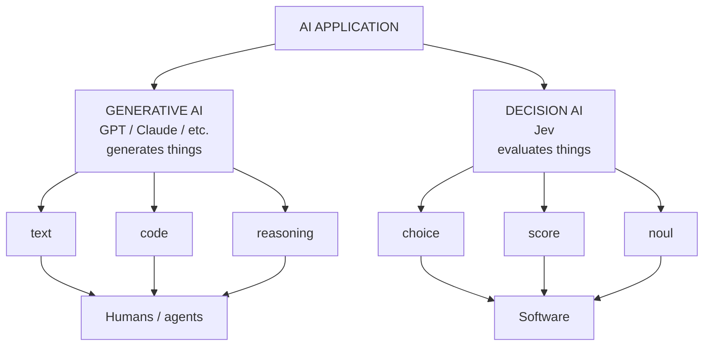
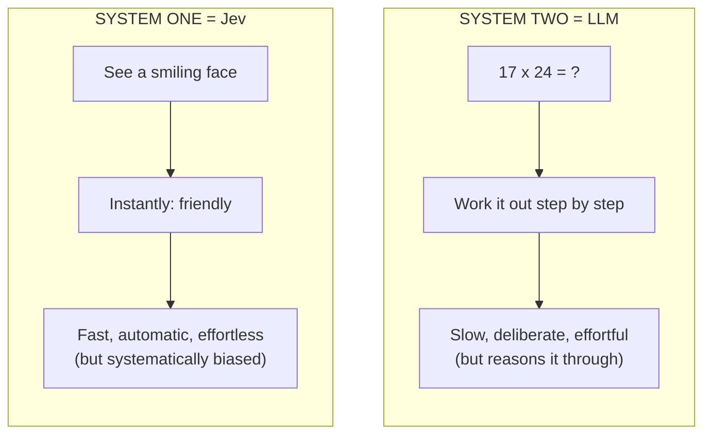
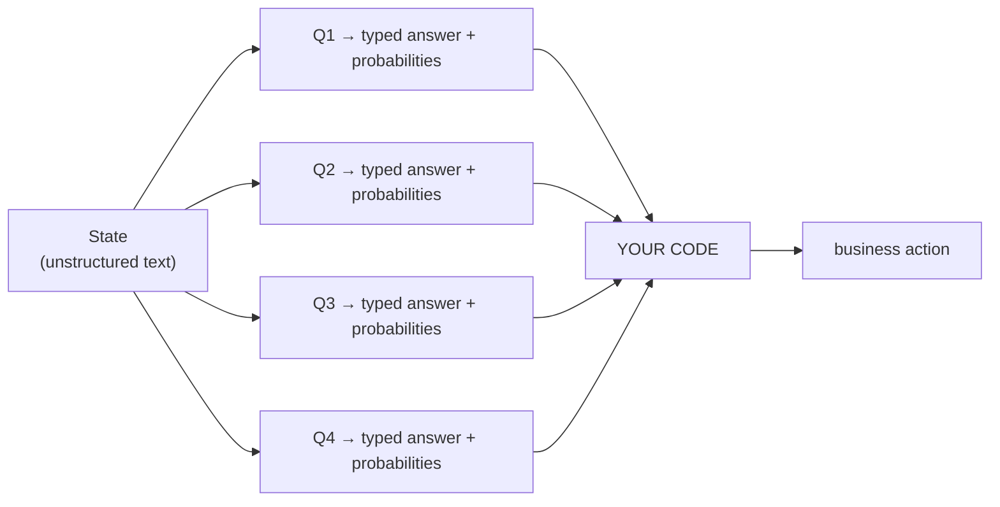
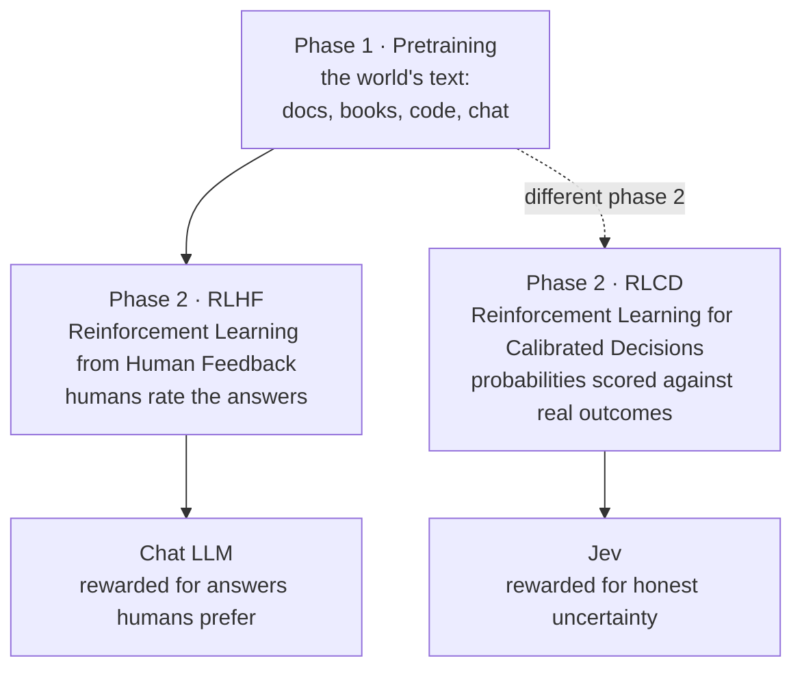
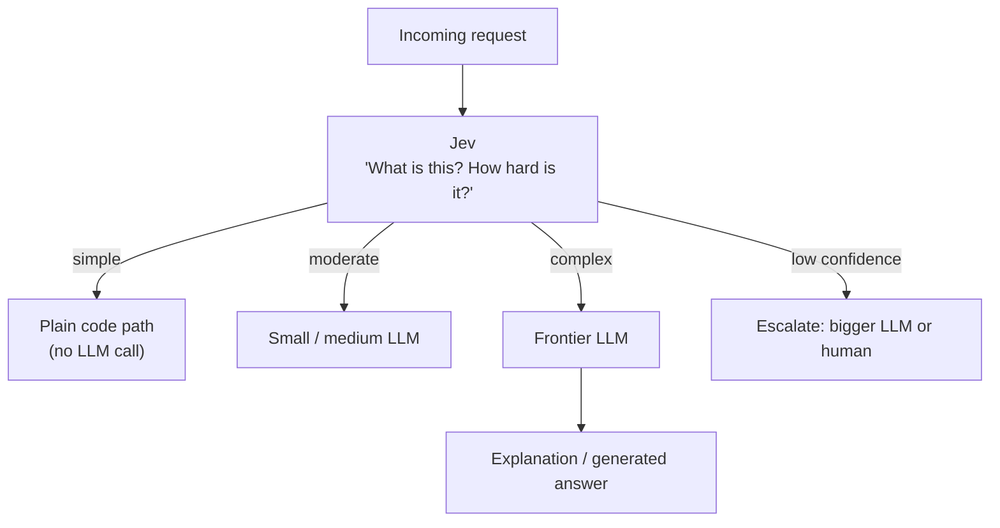
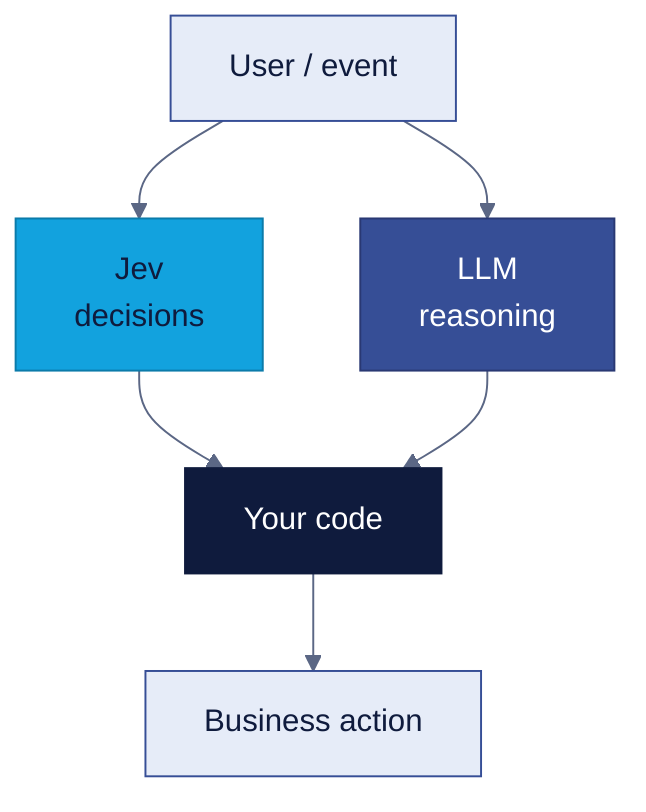

# Jev & System One AI

## 90-Minute Session — Theory + Hands-On Demo + Production Use Cases

**Revision note:** this plan was fact-checked against current public TypeSafe / OpenRouter
material and independent evaluations. Corrections from the first draft are marked
`[FIXED]`. Do not reuse the API shapes or the numbers from the earlier draft or from
`details.md` — several were wrong. See **Appendix A — Errors Corrected**.

---

# 1. Session Objective

### Audience

* Software engineers / IT professionals with some programming experience
* Some audience members may be students with little or no LLM knowledge
* Mixed understanding of AI/LLMs

### Primary objective

By the end of the session, the audience should understand:

1. What an LLM does when generating an answer
2. Why many software problems actually need a **decision**, not generated text
3. What Jev / System One is, and how it produces a result differently from an LLM
4. Why this can change **latency and cost** — and what it costs you in **accuracy**
5. How to use **confidence** to decide how much autonomy to grant the model
6. How Jev fits into production software
7. Where Jev should and should **not** be used

### Central narrative

> **LLM → generates language**
>
> **Jev → produces decisions**
>
> **Code → controls what the system actually does**

### Honest-framing rule for this talk

This is a meetup talk, not a vendor pitch. The strongest version of the argument is
**not** "Jev beats LLMs." It is:

> **Jev is not more accurate than a frontier LLM. It is cheap enough and calibrated
> enough that you can afford to run it on every request and escalate the uncertain ones.**

Every section should be consistent with that sentence.

---

# 2. 90-Minute Agenda `[FIXED]`

The earlier draft packed 42 slides and a 12-minute demo into 90 minutes with **zero
Q&A buffer**. 90 minutes is *room* time, not *content* time. Revised budget:
~66 min slides, ~14 min demo, ~10 min Q&A.

|      Time | Section                                           |
| --------: | ------------------------------------------------- |
|   0–5 min | Hook: do we really need an LLM?                   |
|  5–13 min | LLM fundamentals (open with live token streaming) |
| 13–22 min | The decision problem                              |
| 22–35 min | System One + Jev: Choice / Score / Noul           |
| 35–38 min | **Mini-demo — one question, one response**        |
| 38–46 min | How LLM vs Jev produces results                   |
| 46–54 min | Cost + latency                                    |
| 54–59 min | **Accuracy + calibration (new section)**          |
| 59–70 min | **Main demo — router + confidence gating**        |
| 70–78 min | Production patterns                               |
| 78–83 min | Limits, specs, when not to use                    |
| 83–85 min | Takeaway + resources                              |
| 85–90 min | Q&A                                               |

### Why the demo moved earlier `[FIXED]`

Hands-on was an explicit requirement. A single demo starting at minute 60 is the first
thing sacrificed when you run long — and you will run long. The demo is now **split**:
a 3-minute single-question call at minute 35 (right after the primitives are introduced),
then the full router demo at minute 59. If you overrun, you have still demoed.

---

# SECTION 0 — BEFORE THE SESSION

Not presented. Prep checklist — see **Appendix B**.

---

# SECTION 1 — HOOK (0–5 min)

Two slides, not three.

---

## Slide 1 — Title

### Title

**Jev & System One AI**

### Subtitle

**When software needs decisions, not text**

### Visual

```text
LLM                    Jev
Generate               Decide
   ↓                      ↓
Text                   Typed result
```

### Speaker goal

Don't start with product or API details. Start with the question:

> "When your software calls an AI, does it always need an answer written in English?"

---

## Slide 2 — Real Problem → The Core Question

*(merge of old Slides 2 + 3)*

### Example

Customer sends:

> "My card was charged twice for the same order and I've been waiting for three days.
> Please refund me."

### Ask the audience

> "What does our software actually need here?"

Let them shout answers. They will say: intent, urgency, fraud risk, human review,
refund eligibility.

### Then reveal

The application may only need:

```json
{
  "intent": "refund",
  "urgency": "high",
  "needs_human": true
}
```

### The core question — big text

> **Why run a text-generation engine when the application only needs a decision?**

### Transition

"To answer that, we need 8 minutes on what an LLM actually does."

---

# SECTION 2 — LLM FUNDAMENTALS (5–13 min)

Keep this tight. Students need it; engineers must not get bored.

---

## Slide 3 — Terms We'll Use `[NEW]`

*The mixed-audience problem was asserted in the first draft but never solved. This slide
plus the streaming demo on Slide 4 is the mechanism.*

Leave on screen for 45 seconds, say it's for anyone who wants it, move on fast.

| Term              | Plain meaning                                               |
| ----------------- | ----------------------------------------------------------- |
| Token             | A chunk of text — roughly ¾ of a word                       |
| LLM               | A model that predicts the next token, over and over         |
| Autoregressive    | Each word it writes depends on the words it already wrote   |
| Inference         | One run of the model to get an answer                       |
| Structured output | Forcing the model's answer into a fixed JSON shape          |
| Latency           | How long one call takes                                     |
| Confidence        | How sure the model is — a number, not a guarantee           |

---

## Slide 4 — What an LLM Actually Does `[FIXED — now a live demo]`

**Do not present four ASCII diagrams here.** Open a terminal and stream a response from
any chat model, token by token, with streaming visibly on. 30 seconds.

This single moment does the mixed-audience work: students see *what generation is*,
engineers see *why latency scales with output length*. Both are watching the same thing.

### Then one slide behind it

```text
Input → Tokens → [ Transformer ] → token → token → token → ... → Generated text
                                      ↑________________|
                              each token feeds the next
```

### Say

> "Everything you just watched is one model predicting one token at a time. Nothing
> about that changes when you ask for JSON."

### Do NOT

Transformer math. Attention equations. Training.

---

## Slide 5 — Structured Output Is Not a Decision Model

*(merge of old Slides 6 + 7)*

### Show

```text
LLM → generate tokens → JSON → schema validation → application
```

Modern LLM APIs *can* constrain output to a JSON Schema. That genuinely solves:

* format problems
* parse failures
* schema validation

### But

```text
Question: "Is this customer requesting a refund?"

LLM path:   understand → reason → generate → format → return
Software needs:  YES
```

### Key message

> **Constraining the output format does not change what the engine is. It is still a
> general-purpose text generator doing a narrow software decision.**

### Transition

"That gap is the whole topic of this talk."

---

## Slide 5a — Generative AI vs Decision AI `[NEW — from details.md]`

*Place right after Slide 5. It closes the structured-output argument visually.
Renumber when the deck is built.*



### Say

> "LLMs generate tokens. Jev evaluates questions. One is built for humans and agents to
> read; the other for software to branch on."

---

# SECTION 3 — THE DECISION PROBLEM (13–22 min)

---

## Slide 6 — These Are Decisions, Not Generations

```text
Is this fraudulent?              → YES / NO
Which team owns this ticket?     → Billing / Technical / Account
How urgent is this?              → Low / Medium / High
Which model should handle this?  → Small / Medium / Frontier
Is this reply safe to auto-send? → YES / NO
```

### Say

> "None of these are writing problems. Every one of them is a classification your code
> then branches on."

---

## Slide 7 — Where the Options Sit

```text
                FLEXIBILITY
                    ↑
                    │
Rules ──────────────┼────────────── LLM
                    │
              Decision models
                    │
                    ↓
                 SPEED
```

| Approach       | Strength                              | Weakness                              |
| -------------- | ------------------------------------- | ------------------------------------- |
| Rules          | Fast, free, fully predictable         | Brittle for anything semantic         |
| Traditional ML | Accurate on well-defined tasks        | Needs labelled data + training + ops  |
| LLM            | Flexible, zero-shot, can reason       | Slower and costlier per decision      |
| Decision model | Fast, typed, calibrated, zero-shot    | Narrower; accuracy below frontier LLM |

### One line on alternatives — then move on `[FIXED: moved from minute 82]`

> "Jev is one implementation of this idea. There are others — traditional classifiers,
> LLM + structured outputs, OpenAI's Decisions API, Databricks `ai_decide`, self-hosted
> decision models like AWS's Strands Decider. We're not comparing them today. What
> matters is that decision-oriented AI is a category, not one product."

*The old Slide 38 at minute 82 was dead air. This is the right place for it: one
sentence, early, as honest framing.*

---

# SECTION 4 — SYSTEM ONE + JEV (22–35 min)

Main conceptual section.

---

## Slide 8 — What Is "System One"?

From Kahneman's *Thinking, Fast and Slow*:

```text
System One          System Two
Fast                Slow
Automatic           Deliberate
Effortless          Effortful
Snap judgements     Working through it
```

### Important correction to make out loud `[FIXED]`

Your prep notes had this backwards. **System One is the fast, intuitive one.** System Two
is the slow deliberate one.

### And the caveat that strengthens your argument `[NEW]`

Kahneman's System One is fast **and systematically biased**. That is not a flaw in the
analogy — it is the reason the rest of this talk is about **confidence thresholds**.
A fast intuitive judgement is useful *precisely because* you know when not to trust it.

### Map to AI

```text
System One  →  fast, typed decisions        (Jev)
System Two  →  reasoning, generation        (LLM)
```

Jev does not replace System Two. It is optimised for a different class of work.

### Diagram — System One vs System Two *(replaces `system1vs2.png`)*



### Optional aside, one line only *(replaces the tweet screenshot)*

Source: @ShenSeanChen on X — "intuition is compressed reasoning." Skip it if you are
short on time; it is a speculative direction, not something Jev does today.


---

## Slide 9 — What Is Jev?

### Definition

> **Unstructured state in → typed, calibrated decisions out.**

Released by TypeSafe AI, September 2026. Transformer-based, but **not an LLM**: no
autoregressive decoding, no prose output. Trained with **RLCD** (Reinforcement Learning
for Calibrated Decisions) to address overconfidence and mode-dropping in RLHF-tuned models.

### Visual



Questions run **in parallel and in isolation** against the same state. Adding questions
barely changes response time.

### `[FIXED]` Say this correctly

Jev **is** transformer-based. What it does not do is generate tokens one at a time.
*(The prep notes said "it does not work in a transformer based model" — wrong, and an
engineer in the room will catch it.)*

---

## Slide 10 — The Three Primitives

| Primitive  | Meaning                    | Returns                              | Example                 |
| ---------- | -------------------------- | ------------------------------------ | ----------------------- |
| **Choice** | Pick 1 of up to 255        | choice, probabilities, **confidence** | Which team owns this?   |
| **Score**  | Position on ordered rubric | score, probabilities, **confidence**  | How urgent is this?     |
| **Noul**   | Probability a statement is true | probability 0–1 — **no confidence field** | Is this fraudulent? |

### `[NEW]` Say what the word means

"Noul" is TypeSafe's coined term — there's no acronym to decode. It is their name for a
yes/no probability. Pronounce it, define it once, move on. You will use the word 20 more
times.

### `[FIXED]` Flag the asymmetry now

**Noul returns no separate `confidence`.** The first draft's confidence-gating code
assumed confidence exists on all three — it would have thrown an `AttributeError` live,
on the exact slide arguing that Jev makes automation safer. Call this out here so the
demo lands cleanly.

---

## Slide 11 — Choice

```python
"department": Choice(
    instructions="Which team should handle this",
    criteria={
        "billing":   "Payment, refunds or subscription issues",
        "technical": "Bugs, outages or integration problems",
        "account":   "Login, access or profile questions",
    },
)
```

### Returns

```json
{
  "choice": "billing",
  "probabilities": {"billing": 0.84, "technical": 0.10, "account": 0.06},
  "confidence": 0.78
}
```

### `[NEW]` Teaching point most people miss

`criteria` is a **dict of option → definition**, not a list of labels. Those definitions
are where your accuracy comes from. A bare `{"billing": None, "technical": None}` works,
but you are leaving quality on the table — the model is guessing what your label means.

---

## Slide 12 — Score

```python
"urgency": Score(
    instructions="How time-critical is this request",
    criteria=[
        "Routine — no deadline implied",
        "Time-sensitive — customer is waiting",
        "Critical — money or access is blocked right now",
    ],
)
```

### Returns

```text
score = 1.73   (plus probabilities across levels, plus confidence)
```

### Explain

The score is fractional because it is derived from the **probability distribution across
your ordered levels** — it is a position on the rubric you defined, not a number the
model made up.

### Don't say

> "The model gives you a number out of 10."

### Do say

> "You define the ladder. It tells you which rung, and how sure it is."

---

## Slide 13 — Noul

```python
"needs_human": Noul(
    instructions="This request requires immediate human intervention",
)
```

### Returns

```text
noul = 0.92
```

```text
0.92 → strong yes
0.50 → genuinely uncertain
0.08 → strong no
```

### `[NEW]` The usage detail that bites people

A Noul takes a **statement, not a question**.

```text
✗  "Is this urgent?"
✓  "This message conveys urgency or time-sensitivity."
```

### Repeat

Noul returns a probability and **no separate confidence field**. For a Noul, distance
from 0.5 *is* your confidence signal.

---

## Slide 13b — Where Calibration Comes From: RLHF → RLCD `[NEW — replaces RLHS.png + RLCD.png]`

*Place before Slide 14. Two minutes, conceptual only — no reward-model or RL math.
Renumber when the deck is built.*



### Quote from TypeSafe's docs — put this on the slide verbatim

> "System One models are trained for calibrated decisions: their probabilities are
> optimized against outcomes to reflect uncertainty. **Calibration is measured across
> groups of predictions; it does not guarantee that an individual answer is correct.**"

### Say

> "A chat model is rewarded for answers people like. Jev is rewarded for being right
> about how sure it is. That's what makes the confidence number worth gating on."

### Caveat

The phase 1 → RLCD branch is the conceptual contrast from the source video. TypeSafe has
not published Jev's full training recipe — say "trained for calibrated decisions," not
"here is exactly how." Also note from the same docs page: **text input only**
(strings, JSON objects, arrays of text — no images, audio or video).

---

## Slide 14 — Probability vs Confidence

Important conceptual slide.

### Example

```text
Billing       0.60
Technical     0.25
Account       0.15
→ selected: Billing
```

> "Should our software automatically act on this?"

Not necessarily. A 0.60 top option with a 0.25 runner-up is a flat, uncertain
distribution. Confidence captures the *shape* of the distribution, not just the winner.

### Architecture

```text
                  Jev
                   │
           ┌───────┴────────┐
       Decision         Confidence
           └───────┬────────┘
                   ▼
                 CODE
         ┌─────────┼──────────┐
         ▼         ▼          ▼
      Automate   Verify      Human
```

> **The decision tells you what. The confidence tells you how much autonomy to grant.**

---

# SECTION 5 — MINI-DEMO (35–38 min) `[NEW]`

Three minutes. One question. Prove the thing is real before you spend 20 more minutes
describing it.

---

## Slide 15 — Mini-Demo: One Question

Live, in a terminal or notebook:

```python
from typesafe_sdk import Noul, TypeSafeClient

client = TypeSafeClient()

r = client.system_one(
    state="My card was charged twice and I've been waiting three days. Refund me.",
    model="jev-latest",
    questions={
        "is_refund_request": Noul(
            instructions="The customer is asking for a charge to be reversed",
        ),
    },
)

print(r.answers["is_refund_request"].noul)   # → 0.97
print(r.usage)                                # → input/output token counts
```

### Points to make while it runs

1. It returned in well under a second.
2. It returned a **float**, not a sentence. Nothing to parse.
3. `usage` shows output tokens — and you are not billed for them.

### Then

> "That's the whole idea. The rest of this talk is why that matters and when it fails."

---

# SECTION 6 — HOW RESULTS ARE PRODUCED (38–46 min)

*Old Slides 19 and 22 cut — 19 repeated Slide 4's token diagram, 22 repeated the
comparison table.*

---

## Slide 16 — Side by Side

```text
   LLM                                  JEV

   INPUT                                STATE + QUESTIONS
     ↓                                        ↓
 ┌─────────┐                           ┌─────────────┐
 │  MODEL  │                           │     JEV     │
 └────┬────┘                           └──────┬──────┘
      ↓                                       ↓
   token #1                      ┌────────────┼────────────┐
      ↓                          ▼            ▼            ▼
   token #2                   Choice        Score         Noul
      ↓                          │            │            │
     ...                         ▼            ▼            ▼
      ↓                    probabilities probabilities probabilities
   token #N
      ↓
   RESULT
```

### Core message

> **One generates a sequence. The other evaluates a set — in parallel.**

TypeSafe describes Jev as using a new architecture plus a parallel sampler. The exact
internals are not public — say "parallel evaluation," not "here is how it works inside."

---

## Slide 17 — Comparison Table

|                     | LLM                                | Jev                                   |
| ------------------- | ---------------------------------- | ------------------------------------- |
| Primary purpose     | Generate                           | Decide                                |
| Output              | Text / structured text             | Typed value                           |
| How it's produced   | Token by token, autoregressive     | Parallel evaluation, no decoding      |
| Output tokens       | Generated and billed               | Not generated as prose, not billed    |
| Answer space        | Open-ended                         | Defined by your question              |
| Multiple decisions  | More calls or more generation      | Batched into one request              |
| Confidence signal   | Needs extra work (logprobs, juries)| Native, and RLCD-calibrated           |
| Accuracy ceiling    | Higher                             | **Lower — see Section 8**             |
| Best at             | Reasoning, writing, code           | High-volume semantic decisions        |

### Key phrase

> **An LLM produces language. Jev produces a value your program can branch on directly.**

### Then the pipeline difference

```text
LLM:  generate → parse → validate → interpret → business logic
Jev:  decide → business logic
```

---

# SECTION 7 — COST + LATENCY (46–54 min)

---

## Slide 18 — The Two Cost Models

### How LLM cost is built

```text
Cost = input tokens
     + output tokens          ← usually the expensive half
     × number of calls
     × retries
     + orchestration
```

Even a one-word decision requires the model to run a full generation pass.

### Jev's published pricing

```text
Input:   $0.042 per 1M tokens
Output:  free (not metered)
```

*Label this as:* **vendor, early-access pricing — subject to change.** TypeSafe itself
notes it cannot prove the price is unsubsidised. Verify before the session.

### Don't say

> "Jev is always 400× cheaper."

### Do say

> "For decision-heavy workloads the economics are different in kind, because the
> expensive half of the bill — generated output — isn't there."

---

## Slide 19 — Batching: The Strongest Cost Argument

### Serial LLM approach

```text
Ticket → LLM → intent
       → LLM → urgency
       → LLM → fraud
3 calls, 3 generations, 3 round trips
```

### Jev

```text
                 Ticket
                    ↓
                   Jev          ← one request
          ┌─────────┼─────────┐
          ▼         ▼         ▼
        intent   urgency    fraud
```

### Published figure

13 questions batched into one request: **$0.000497** — about a twentieth of a cent —
and **12.2× cheaper / 10× faster** than the same 13 questions as separate calls.
*(Vendor-reported.)*

> **Same state, many decisions, one request.**

---

## Slide 20 — Latency

```text
LLM:  request → inference → generate → generate → ... → response
                                ↑
                 latency scales with output length

Jev:  request → parallel evaluation → typed result
```

### The number

Vendor-reported end-to-end: **70 ms – 500 ms**, workload dependent.

### `[FIXED]` Presentation discipline

Do **not** say "Jev is always under 100 ms." The public range is wider than that.

Say either:

> "TypeSafe reports 70 to 500 ms end-to-end."

or, if you measured it yourself:

> "In our demo workload we measured p50 of X ms and p95 of Y ms."

Measure it during prep and put your own p50/p95 on the slide. Your own number from your
own network is far more persuasive than a vendor range.

---

# SECTION 8 — ACCURACY & CALIBRATION (54–59 min) `[NEW SECTION]`

**This was the single biggest gap in the first draft.** Ten minutes on cost, ten on
latency, zero on whether it is right. The moment you say "444× cheaper" to a room of
engineers, the next thought in every head is *"at what accuracy?"* Answer it before they
ask, or the whole talk reads as a vendor pitch.

---

## Slide 21 — "But Is It Actually Right?"

### Vendor benchmark

On TypeSafe's own 4-workflow benchmark, Jev scores **~68%** — close to mid-tier LLMs,
at 40–400× lower cost and 20–200× lower latency.

### The caveat you must state

In that benchmark, the "correct answer" is defined as **the average of GPT-6 Astra's and
Fable 5.1's answers.** So it measures *how often Jev agrees with two other models* — not
accuracy against ground truth. The workflows were also authored by TypeSafe's own
capabilities team.

> **Label it: vendor-run benchmark, model-agreement metric.**

---

## Slide 22 — Independent Results

| Task                                 | Jev        | Frontier LLM                        |
| ------------------------------------ | ---------- | ----------------------------------- |
| Phishing detection, 2,000 emails     | **62.6%**  | Claude Haiku 4.5 — **81.3%**        |
| 77-intent banking routing            | **78.3%**  | Opus 5.5 85.7% / GPT-6 Sol 85.3%    |

On the routing task the ~7-point gap was statistically significant.

### Calibration — the part that redeems it

* On classification, Jev's confidence was **well calibrated**: at confidence ≥ 0.9 it was
  right **94–96%** of the time.
* On the single-judgement phishing task, calibration error **0.154** vs Haiku's **0.097**.

### Say it plainly

> "On raw accuracy, a frontier LLM beats it. That's not the pitch."

---

## Slide 23 — So What Is the Pitch?

### Full-screen statement

> **Jev is not more accurate than a frontier LLM.**
>
> **It is cheap enough to run on every request, and calibrated enough to know when to
> hand off.**

```text
1,000,000 requests
        ↓
       Jev          ~$17 of input, <500ms each
        ↓
  confidence ≥ 0.9 → auto-handle        (~94-96% correct)
  confidence < 0.9 → escalate to LLM or human
```

### The engineering insight

You are not choosing Jev *instead of* an LLM. You are using a cheap calibrated model as a
**first-pass filter** so the expensive model only sees the hard cases. That is why
accuracy per-call matters less than **accuracy at high confidence** — and that second
number is good.

### Also note

Accuracy is unusually sensitive to how you phrase the question and define the criteria —
independent testers found it swings noticeably with prompt wording. Budget real time for
question design and evals. This leads directly to Slide 32.

---

# SECTION 9 — MAIN DEMO (59–70 min)

One demo. Do not switch between unrelated examples.

### Flow

```text
1. Show the customer ticket
2. Ask the room: "what does the application need?"
3. Send ONE Jev request with three questions
4. Show Choice / Score / Noul coming back
5. Show probabilities + confidence
6. Apply plain Python business logic
7. Add confidence gating
8. Show the final action
9. Show the timing and the cost of that call
```

---

## Slide 24 — Demo: Support Ticket Router

### State

```text
"My card was charged twice for the same order.
 I've been waiting for three days.
 Please refund the duplicate charge ASAP."
```

### Three questions

```text
intent       → Choice
urgency      → Score
needs_human  → Noul
```

---

## Slide 25 — The Request `[FIXED — the first draft's shape was wrong]`

```python
from typesafe_sdk import Choice, Noul, Score, TypeSafeClient

client = TypeSafeClient()          # reads TYPESAFE_API_KEY from env

response = client.system_one(
    state=ticket,
    model="jev-1.13.0",            # pin a version in production
    questions={
        "intent": Choice(
            instructions="Which team should handle this ticket",
            criteria={
                "billing":   "Payment, refunds or duplicate charges",
                "technical": "Bugs, outages or integration problems",
                "account":   "Login, access or profile questions",
            },
        ),
        "urgency": Score(
            instructions="How time-critical is this request",
            criteria=[
                "Routine — no deadline implied",
                "Time-sensitive — customer is waiting",
                "Critical — money or access is blocked right now",
            ],
        ),
        "needs_human": Noul(
            instructions="This request requires immediate human intervention",
        ),
    },
)
```

### HTTP equivalent — show briefly for the non-Python folks

```bash
curl https://api.typesafe.ai/v1/systemone \
  -H "Authorization: Bearer $TYPESAFE_API_KEY" \
  -H "Content-Type: application/json" \
  -d '{
    "model": "jev-1.13.0",
    "state": "My card was charged twice...",
    "questions": {
      "needs_human": {
        "type": "noul",
        "instructions": "This request requires immediate human intervention"
      }
    }
  }'
```

### Mental model

```text
state  +  question definitions  →  Jev  →  typed answers
```

### `[FIXED]` What changed from the first draft

The draft showed `{"state", "model", "questions": {"intent": {"type": "choice", ...}}}`
with the important parts elided. The real SDK surface is `instructions` + `criteria`, and
`criteria` differs by type: **dict** for Choice, **ordered list** for Score, **absent**
for Noul.

---

## Slide 26 — The Response `[FIXED]`

Results come back under **`answers`**, keyed by *your* question ids — plus `model` and
`usage`:

```python
response.answers["intent"].choice            # "billing"
response.answers["intent"].probabilities     # {"billing": 0.91, ...}
response.answers["intent"].confidence        # 0.86

response.answers["urgency"].score            # 1.8
response.answers["urgency"].confidence       # 0.74

response.answers["needs_human"].noul         # 0.91   ← no .confidence

response.usage                               # {"input": 118, "output": 12}
```

### Key message

Nothing here needs parsing, repairing or retrying. It is already the type your code wanted.

---

## Slide 27 — Business Logic + Confidence Gating `[FIXED]`

### Step 1 — plain branching

```python
a = response.answers

if a["needs_human"].noul >= 0.85:
    route_to_human(ticket)
elif a["intent"].choice == "billing" and a["urgency"].score > 1.5:
    fast_track_refund(ticket)
else:
    normal_queue(ticket)
```

### Step 2 — add confidence gating

```python
HIGH, MEDIUM = 0.85, 0.60

intent = a["intent"]

# Noul has no .confidence — distance from 0.5 is the signal
human_signal = a["needs_human"].noul
human_certainty = abs(human_signal - 0.5) * 2

if human_signal >= 0.85 and human_certainty >= 0.6:
    route_to_human(ticket)
elif intent.confidence >= HIGH:
    auto_route(ticket, intent.choice)
elif intent.confidence >= MEDIUM:
    auto_route_with_audit_flag(ticket, intent.choice)
else:
    escalate_to_llm(ticket)        # or to a human
```

### `[FIXED]` Why this version matters

The first draft's gating code called `confidence` uniformly across all three answers.
**Noul has no `confidence` field** — that code raises `AttributeError`, live, on the slide
where you are arguing Jev makes automation safer. This version handles the asymmetry
explicitly and gives you a good thing to say out loud about reading the docs.

### Key message

> **Jev does not own the business workflow.**

Your code owns thresholds, actions, side effects, permissions and escalation. The model
contributes one semantic signal.

> **AI confidence becomes an input to deterministic software logic.**

### Close the demo with

Print the wall-clock time and the token usage for that one call. Three decisions, one
request, sub-second, a fraction of a cent. That's the takeaway image.

---

# SECTION 10 — PRODUCTION PATTERNS (70–78 min)

`[FIXED]` Three patterns, not four — and the first one is **costed with real numbers**.
The original ask was for production use cases *shown*; four hypothetical architecture
diagrams don't meet that.

---

## Slide 28 — Pattern 1: Intent Routing (worked example)

```text
Incoming ticket
      ↓
     Jev          ← intent + urgency + needs_human, one request
      ↓
┌─────┼──────────┐
▼     ▼          ▼
Billing Technical Account
      ↓
specialized workflow
```

### Make it concrete — adapt these numbers to your own volumes

```text
1,000,000 tickets / month
~400 input tokens of state each
5 questions per ticket, batched into 1 request

Jev side:
  400 tokens × 1M = 400M input tokens
  400M × $0.042 / 1M = $16.80 / month
  output: free
  1 request per ticket

LLM side (fill in your model's current input + output price before the talk):
  400M input tokens
  + ~80 output tokens × 1M = 80M output tokens
  × 1 call if batched, × 5 if not
```

### `[IMPORTANT]` Label this slide

> **"Our estimate — illustrative volumes, current list prices, not a vendor benchmark."**

Compute the LLM side during prep using *today's* published prices and show the actual
delta. Do not present a ratio you cannot reconstruct on stage.

### Also real

Fits: customer support, internal IT tickets, incident routing, document routing.

---

## Slide 29 — Pattern 2: Model Routing



Use the confidence from the response to decide whether to rely on the routing decision
at all.

### Why this is the most defensible pattern

It is the Slide 23 argument made structural: a cheap calibrated model decides who does the
expensive work. If Jev is wrong, the cost is a suboptimal routing decision, not a wrong
answer to the user — the frontier model still produces the output.

### Value

Lower average cost, lower average latency, better use of model tiers.

---

## Slide 30 — Pattern 3: Risk / Fraud / Policy Triage

```text
Customer / Order / Device / Event
              ↓
             Jev
              ↓
    risk signal + confidence
              ↓
      deterministic rules engine
              ↓
     allow / review / block
```

Fits: fraud detection, abuse detection, content policy, trust & safety, transaction
review, compliance triage.

### Key message

Jev does not make the final business decision. It supplies the **semantic signal** that
feeds a decision engine you already own and can audit.

### `[FIXED]` The agent-guardrail variant — and its honest caveat

A popular framing is to put a decision model in front of an LLM agent's tool calls:

```text
LLM agent → proposes tool call → Jev → allow / review / block
```

**Present this as risk reduction, not as a security boundary.** Jev is documented to be
susceptible to adversarial input embedded in the state you pass it — which, for an agent
guardrail, is exactly where attacker-controlled text lives. A probabilistic classifier
that can be talked out of its answer is not an authorization layer.

Use it to catch mistakes. Use deterministic permissions to stop attacks. This is the same
point as Slide 27: your code stays authoritative.

---

# SECTION 11 — LIMITS & WHEN NOT TO USE (78–83 min)

---

## Slide 31 — The Specs Card `[NEW]`

These are the questions engineers will ask in Q&A. Have one slide.

| | |
| ------------------- | ----------------------------------------------- |
| Endpoint            | `POST https://api.typesafe.ai/v1/systemone`     |
| Also available via  | OpenRouter Decisions API                        |
| SDKs                | `pip install typesafe-sdk` (3.10+), `@typesafe-ai/sdk` |
| Models              | `jev-latest` → currently `jev-1.13.0`           |
| Context window      | 64k tokens per request                          |
| Rate limits         | 1,200 req/min · 250k tokens/sec                 |
| Choice options      | up to 255                                       |
| Questions/request   | no stated max — bounded by the 64k context      |
| Modalities          | **text only** — no image, audio or video        |
| Languages           | English most accurate; CJK and others, variable |
| Pricing             | $0.042 / 1M input · output free                 |
| Latency             | 70–500 ms end-to-end (vendor-reported)          |
| Availability        | **early access** — no open weights, no self-hosting |

### Say the last row out loud

Early access, closed weights, single vendor, unproven pricing durability. That is a real
procurement risk and the room will respect you for naming it.

---

## Slide 32 — Where It Breaks `[FIXED — the draft's list was too generic]`

### Good for

```text
✓ Classification and routing
✓ Scoring against a rubric
✓ Yes/no semantic judgements
✓ Risk and triage signals
✓ High-volume, latency-sensitive decisions
✓ First-pass filtering before an expensive model
```

### Documented failure modes — be specific

```text
✗ Arithmetic and counting
✗ Date comparisons, mixed date formats
✗ Multi-hop reasoning
✗ Double negatives
✗ Noisy / irrelevant state — accuracy degrades
✗ Adversarial text inside user-supplied state
✗ Long-form generation, chat, code — it does not generate at all
```

### `[NEW]` The one engineers care about most

> **There is no logical consistency guarantee between related questions in the same
> request.**

Each question is evaluated in isolation. Ask "is this a refund request?" and "is this a
technical issue?" and you can get a confident *yes* to both. If your questions are
mutually exclusive, **your code** must enforce that — the model will not.

### Key message

> **Use the smallest AI primitive that solves the problem — and own the invariants
> yourself.**

---

## Slide 33 — Question Quality & Threshold Policy

*(merge of old Slides 40 + 41)*

### Decision quality follows question quality

```text
✗  "Analyze this customer and decide what we should do."

✓  Is the customer requesting a refund?
✓  How urgent is the request?
✓  Does this require human intervention?
```

> **Break one fuzzy decision into several explicit ones.** That's what the API is shaped
> for — and recall from Slide 23 that accuracy is measurably sensitive to phrasing, so
> this is where your eval effort goes.

### Thresholds are a risk decision, not a model setting

```text
Low-risk, reversible action      → lower threshold
High-risk action                 → higher threshold
Destructive / irreversible       → human confirmation, always
```

### Never say

> "Jev is 90% confident, so we're safe."

### Say

> "Confidence is a signal our software uses to decide how much autonomy to grant."

### And on "zero hallucinations"

If someone raises the phrase: it means **schema conformance is guaranteed — you will
always get a valid value of the type you asked for.** It does **not** mean the answer is
correct. A confidently wrong, perfectly typed answer is still wrong.

---

# SECTION 12 — CLOSE (83–85 min)

---

## Slide 34 — The Big Takeaway

### Full screen

> **LLM = Generate**
>
> **Jev = Decide**
>
> **Code = Control**

### Supporting visual

```text
                 USER / EVENT
                      ↓
             ┌────────┴─────────┐
             ▼                  ▼
           Jev                 LLM
        Decisions           Reasoning
             │                  │
             └────────┬─────────┘
                      ▼
                    CODE
                      ↓
               BUSINESS ACTION
```

### The decision tree to leave them with

```text
              What does my software need?
                        │
          ┌─────────────┼───────────────┐
          ▼             ▼               ▼
      Deterministic   Decision       Generation
          ▼             ▼               ▼
        Rules          Jev             LLM

Calculate tax                → Code
Is this fraudulent?          → Jev (+ human on low confidence)
Which queue does this go to? → Jev
Write the customer's reply   → LLM
Write code                   → LLM
```

### Final statement

> **The future of AI engineering isn't one model doing everything. It's software
> combining the right intelligence primitive for each job — and owning the decisions
> that matter.**

---

## Slide 35 — Resources `[NEW]`

The first draft ended with a philosophical statement and nothing actionable.

```text
Docs        https://docs.typesafe.ai
Endpoint    POST https://api.typesafe.ai/v1/systemone
Python      pip install typesafe-sdk
JS/TS       npm install @typesafe-ai/sdk
Via OpenRouter   openrouter.ai/docs/guides/community/jev
Access      early access — sign up / waitlist

Today's demo code:  <your repo or gist URL>
These slides:       <URL>
Contact:            <you>
```

Put a QR code to the repo on this slide and leave it up through Q&A.

---

# Q&A (85–90 min)

### Questions you will get — have answers ready

| Question | Short answer |
| -------- | ------------ |
| "Is it more accurate than GPT/Claude?" | No. Slide 22. It's cheaper and well calibrated. |
| "Can I self-host it?" | No. Closed weights, early access. |
| "What if TypeSafe changes pricing?" | Real risk. Name it. Design so the decision layer is swappable. |
| "Why not fine-tune a BERT classifier?" | Valid for a fixed label set with labelled data. Jev's edge is zero-shot and changing questions. |
| "Why not just use structured outputs?" | Slide 5 — you still pay for generation and get no calibrated confidence. |
| "How do I evaluate it?" | Hold out a labelled set, measure accuracy *at your threshold*, not overall. |
| "Does it hallucinate?" | Schema: no. Facts: yes. Slide 33. |

---

# Appendix A — Errors Corrected From the First Draft

Keep this list. Do not reintroduce any of these.

| # | Where | Error | Correct |
| - | ----- | ----- | ------- |
| 1 | `details.md` L4 | "System 1 thinks a lot before pushing the answer" | System One is the **fast, intuitive** one |
| 2 | `details.md` L85 | "Output not charged because it does not work in a transformer based model" | Jev **is** transformer-based; it is not **autoregressive** |
| 3 | `details.md` L7–8 | "10× faster, 100× cheaper than Opus" — unsourced | Vendor claim is 193.6× faster / 444.6× cheaper **vs GPT-5.6 Terra**, vendor-run |
| 4 | old Slide 30 | Request used `{"type": "choice", ...}` with details elided | `Choice(instructions=..., criteria={...})`; Score takes an ordered **list**; Noul takes neither |
| 5 | old Slide 31 | Flat response object | Results under `response.answers[...]`, plus `model` and `usage` |
| 6 | old Slides 18/33 | Assumed `confidence` on all three primitives | **Noul has no `confidence` field** — would have crashed live |
| 7 | — | No accuracy content at all | New Section 8 — vendor benchmark caveat, independent results, calibration |
| 8 | — | No specs/limits | New Slide 31 |
| 9 | old Slide 39 | Generic "not good for" list | Documented failure modes incl. **no cross-question consistency** |
| 10 | old Slide 35 | Agent guardrails framed as a control layer | Risk reduction only — Jev is injectable via state |
| 11 | old Slide 38 | Competitors at minute 82 | One sentence at minute ~20 (Slide 7) |
| 12 | Agenda | 42 slides, 90 min, no Q&A | 35 slides, demo split and moved earlier, 10 min Q&A |
| 13 | — | No resources slide | Slide 35 |

---

# Appendix B — Prep Checklist

### Must do before the session

- [ ] **Decide: does the audience code along, or watch?** See below — decide now, it
      changes your prep significantly.
- [ ] Get API access. It is **early access / waitlist** — start this early.
- [ ] Run the full demo end to end on the venue network if possible.
- [ ] **Measure your own p50/p95 latency** and put it on Slide 20.
- [ ] **Compute the LLM side of Slide 28** with today's published prices.
- [ ] Re-verify pricing, latency range and model version the morning of the talk —
      everything here is from an early-access product and moves.
- [ ] Build the demo fallback (below).
- [ ] Print/host the demo repo and generate the QR code for Slide 35.

### Hands-on: decide the format `[OPEN DECISION]`

The original brief said "hands-on demo." That can mean two very different things:

**Option A — audience watches you.** What this plan currently assumes. Low risk, no prep
for attendees. Everyone still gets the repo on Slide 35.

**Option B — audience codes along.** Much stronger for the students in the room, but Jev
is early-access — **your attendees will not have API keys.** Realistic route: a Colab
notebook that calls through *your* key via a thin proxy, with a hard rate cap. Needs
building and testing ahead of time, plus a venue-wifi contingency.

Recommendation: **Option A for the live session, with the Colab from Option B shared on
Slide 35** so motivated attendees can run it afterwards. You get the demo reliability and
they still get the hands-on.

### Demo fallback — non-negotiable

Early-access API + conference wifi + a live audience. Before the session:

- [ ] Record a clean screen capture of the full demo.
- [ ] Cache the real JSON responses and add an `--offline` flag that replays them.
- [ ] Have the expected output on a slide so you can keep talking if everything fails.

A demo this central to the talk cannot have a single point of failure.

---

# Appendix C — Claim Labelling Discipline

Whenever you make a claim like:

```text
"X times faster"   "X times cheaper"   "<100 ms"
"zero hallucinations"   "more accurate"
```

state which category it is, out loud:

```text
Vendor claim           ← most numbers in this deck
Our own measurement    ← your latency, your cost calc
Independent benchmark  ← the Slide 22 numbers
Conceptual advantage   ← "no generated output to pay for"
```

Never mix them in the same sentence. A room of engineers will trust the talk far more if
you are visibly careful about this than if every number is impressive.

---

# Appendix D — Things NOT to Spend Time On

* Transformer mathematics, attention equations
* Training implementation details — RLHF → RLCD is covered conceptually on Slide 13b
  only; no reward-model or RL math
* Jev's undisclosed architecture — say "parallel evaluation" and stop
* Point-by-point competitor comparison
* Pricing across every provider
* Benchmark methodology beyond the one caveat on Slide 21
* SDK edge cases
* Building a full production application

Mention only as far as the main story needs.

---

# Appendix E — Sources

Verify these again close to the session date; Jev is early-access and details move.

* OpenRouter — Jev documentation: <https://openrouter.ai/docs/guides/community/jev>
* OpenRouter — What is Jev: <https://openrouter.ai/blog/insights/what-is-jev/>
* MarkTechPost — TypeSafe releases Jev: <https://www.marktechpost.com/2026/09/19/typesafe-ai-releases-jev/>
* How to use Jev — setup, examples and limits: <https://toolscout.ai/news/how-to-use-jev>
* Failproof AI — Jev quickstart: <https://befailproof.ai/jev/build/quickstart/>
* DataCamp — System One models explained: <https://www.datacamp.com/blog/system-one-models-jev>
* XenoSpectrum — independent accuracy testing: <https://xenospectrum.com/en/jev-typesafe-bert-classifier-decomposition/>
* Jev benchmarks — what the numbers show: <https://jev-ai.org/blog/jev-benchmarks/>
* Langfuse — using Jev for evals: <https://langfuse.com/blog/2026-09-18-using-typesafes-jev-for-evals>
* AWS Strands Decider — open reference for the decision-model category

---

# Appendix F — Brand & Slide Design Guideline (Rebind Rise)

Derived from `main_logo.png` (1250×199 RGBA). The logo is an **indigo → cyan** gradient
on a transparent background. The "measured" colors below were sampled from its pixels;
the "derived" ones are added so the deck has a text-safe cyan, dark backgrounds and
status colors the logo does not contain. Every text/background pairing was checked
against WCAG contrast.

## F1. Palette

### Brand colors (measured from the logo)

| Role | Name | Hex | Where it appears in the logo |
| ---- | ---- | --- | ---------------------------- |
| **Primary** | Rebind Indigo | `#364E96` | "Rebind" wordmark, left half of the RR mark |
| Primary, deep | Deep Indigo | `#293873` | Darkest shade of the RR mark |
| **Accent** | Rise Cyan | `#12A2DE` | "Rise" wordmark, tagline "Learn. Build." |
| Accent, light | Sky Cyan | `#64D1E5` | Arrow tip and highlights |

### Derived colors (not in the logo — added for legibility)

| Role | Name | Hex | Use |
| ---- | ---- | --- | --- |
| Ink / dark background | Midnight | `#0F1B3D` | Body text on light slides; background on dark slides |
| Cyan for text | Ocean | `#0B7BAA` | Cyan-family text or links on light backgrounds |
| Muted text | Slate | `#5B6785` | Captions, sources, footers |
| Slide background | Mist | `#F4F7FC` | Default slide background |
| Panel fill | Tint | `#E6ECF8` | Cards, table headers, code-block backing |
| Page white | White | `#FFFFFF` | Cards on Mist, text on indigo or midnight |

### Status colors (use sparingly, and only with their label word)

| Meaning | Hex | Use in this deck |
| ------- | --- | ---------------- |
| Success | `#15803D` | "✓ good for", "independent benchmark" |
| Caution | `#B45309` | "vendor claim", "early access", `[FIXED]`-style warnings |
| Danger | `#B3261E` | "✗ breaks on", "do not say" |

### Gradient

`linear-gradient(90deg, #364E96 0%, #12A2DE 100%)` — the logo's own left-to-right sweep.
Use it for **one** thing per slide at most: the title slide background, a section-divider
bar, or the key full-screen statement. Never behind body text.

## F2. Semantic mapping — color carries the talk's argument

The central narrative is *LLM → generates, Jev → decides, Code → controls*. Give each a
fixed color and use it everywhere (diagrams, tables, code callouts), so the audience
learns the mapping without being told.

| Concept | Color | Hex |
| ------- | ----- | --- |
| **LLM** (generate, System Two) | Rebind Indigo | `#364E96` |
| **Jev** (decide, System One) | Rise Cyan | `#12A2DE` |
| **Your code** (control) | Midnight | `#0F1B3D` |
| Human / escalation | Caution | `#B45309` |

Rule: **never swap these between slides.** If the LLM is indigo on slide 4, it is indigo
on slide 30.

## F3. Contrast — what is safe to pair (measured)

| Text on background | Ratio | Verdict |
| ------------------ | ----: | ------- |
| Midnight `#0F1B3D` on White | 16.9 | Body text |
| Indigo `#364E96` on White | 7.8 | Headings, emphasis |
| Indigo `#364E96` on Mist `#F4F7FC` | 7.3 | Headings, emphasis |
| Slate `#5B6785` on Mist | 5.3 | Captions only |
| Ocean `#0B7BAA` on White | 4.7 | Cyan text, 18pt+ preferred |
| White on Indigo `#364E96` | 7.8 | Title bars, buttons |
| White on Midnight | 16.9 | Dark-slide body text |
| Sky Cyan `#64D1E5` on Midnight | 9.5 | Dark-slide accents |
| Midnight on Rise Cyan `#12A2DE` | 5.8 | Text inside cyan shapes |
| **Rise Cyan `#12A2DE` on White** | **2.9** | **Fails. Decorative or ≥ 24pt bold only.** |
| **White on Rise Cyan `#12A2DE`** | **2.9** | **Fails. Use Midnight text on cyan instead.** |

The two bold rows are the trap: the logo's own cyan is too light for white text and for
small text on white. The logo gets away with it because the wordmark is huge; body text
cannot. Use Ocean for cyan-family text, or put Midnight text inside cyan shapes.

For a projector in a bright room, aim for ≥ 7:1 on anything the audience must read.

## F4. Slide templates

Three templates are enough for the whole deck.

| Template | Background | Text | When |
| -------- | ---------- | ---- | ---- |
| **Standard** | Mist `#F4F7FC` | Midnight body, Indigo headings | Most slides |
| **Statement** | Midnight `#0F1B3D` | White, one Sky Cyan key phrase | Full-screen claims (Slide 23, 34, section openers) |
| **Demo / code** | Midnight `#0F1B3D` | Code in White, keywords Sky Cyan | Live-demo and code slides, so the terminal and the slide feel continuous |

Title slide: gradient background, logo on a White rounded panel (the logo's indigo does
not read against a dark or gradient ground), title in White. **The logo appears on the
title slide only — not on any other slide.**

## F5. Typography

The logo wordmark is a squared geometric sans, so pair it with a clean sans.

| Use | Font | Size |
| --- | ---- | ---- |
| Slide title | Inter or Poppins, Semibold | 40–44pt |
| Body | Inter, Regular | 24–28pt, **never below 22pt** |
| Table text | Inter | 20pt minimum |
| Code | JetBrains Mono or Fira Code | 20–22pt, max ~12 lines per slide |
| Caption / source | Inter | 16pt, Slate |

If a table does not fit at 20pt, split it or move it to a backup slide. Shrinking the
font is how decks become unreadable from the back row.

## F6. Layout rules

* **One idea per slide.** If the title needs "and", it is two slides.
* Maximum ~6 lines of text, or one diagram, or one code block per slide. Not two.
* Left-align text. Center only full-screen statements.
* Margins ≥ 5% of the slide width on every side.
* No logo and no tagline on content slides. Footer is the slide number only, bottom-left,
  in Slate.
* One accent per slide. A slide with indigo, cyan, amber and red all at once says nothing.

## F7. Claim-label chips (ties to Appendix C)

Put a small colored chip next to every number so the source category is visible at a
glance. Same text label as Appendix C; the color is the redundant cue, so the deck still
works in greyscale and for color-blind viewers.

| Chip | Fill | Text |
| ---- | ---- | ---- |
| VENDOR CLAIM | `#FDF0DD` | `#92400E` (6.3:1) |
| OUR MEASUREMENT | `#E6ECF8` | `#364E96` (6.6:1) |
| INDEPENDENT | `#DDF3E4` | `#166534` (6.1:1) |
| CONCEPTUAL | `#E6F6FD` | `#0F1B3D` (15.2:1) |

Chip text uses darker shades than the plain status colors in F1, because the tinted
fills lower the contrast of the standard amber and green below 4.5:1.

## F8. Diagram styling — mermaid theme

Paste this as the first lines of any mermaid diagram in this plan to render on-brand.
In Mermaid Live, Slidev, Marp or Mermaid-enabled Notion/Obsidian, it applies as written.

```text
%%{init: {
  "theme": "base",
  "themeVariables": {
    "fontFamily": "Inter, Arial, sans-serif",
    "fontSize": "18px",
    "primaryColor": "#E6ECF8",
    "primaryBorderColor": "#364E96",
    "primaryTextColor": "#0F1B3D",
    "secondaryColor": "#E6F6FD",
    "secondaryBorderColor": "#12A2DE",
    "secondaryTextColor": "#0F1B3D",
    "tertiaryColor": "#F4F7FC",
    "tertiaryBorderColor": "#5B6785",
    "tertiaryTextColor": "#0F1B3D",
    "lineColor": "#5B6785",
    "clusterBkg": "#F4F7FC",
    "clusterBorder": "#5B6785",
    "edgeLabelBackground": "#FFFFFF"
  }
}}%%
```

Then use these `classDef` lines to apply the semantic mapping from F2:

```text
classDef llm   fill:#364E96,stroke:#293873,color:#FFFFFF;
classDef jev   fill:#12A2DE,stroke:#0B7BAA,color:#0F1B3D;
classDef code  fill:#0F1B3D,stroke:#0F1B3D,color:#FFFFFF;
classDef human fill:#FDF0DD,stroke:#B45309,color:#92400E;
```

Example — the Slide 34 takeaway, on-brand:



Mermaid is for drafting. For the final deck, export each diagram to SVG and place it, or
redraw it natively in your slide tool using the hex codes above.

## F9. Do / Don't

| Do | Don't |
| -- | ----- |
| Use Ocean `#0B7BAA` for cyan text on light slides | Put white text on Rise Cyan (2.9:1) |
| Show the logo once, on the title slide, on a white panel | Repeat the logo or tagline on every slide, or place it directly on Midnight or the gradient |
| Use the gradient once per slide at most | Put the gradient behind body text or tables |
| Keep LLM = indigo, Jev = cyan, Code = midnight everywhere | Recolor concepts to make a slide look varied |
| Pair status colors with a word ("VENDOR CLAIM") | Rely on color alone to convey meaning |
| Export diagrams as SVG | Paste screenshots of third-party sources into the deck |

## F10. Implementation checklist

- [ ] Copy `main_logo.png` into `meetup/jev/` and ask Rebind Rise for an SVG and a
      white/knocked-out version. The PNG has a transparent background, so a one-color
      white logo is only needed if you later decide to put the logo on a dark ground.
      With the logo on the title slide only, the PNG on a white panel is enough.
- [ ] Define the palette as theme colors in the slide tool (Google Slides, Keynote,
      PowerPoint, Slidev or Marp), so slides pick colors from the theme instead of hex.
- [ ] Build the three templates from F4 as slide masters.
- [ ] Apply the F8 init block to each mermaid diagram, export to SVG and place it.
- [ ] Do a back-row legibility check: project the deck, stand at the far wall, and read
      Slide 3, Slide 12 and the code slide.
